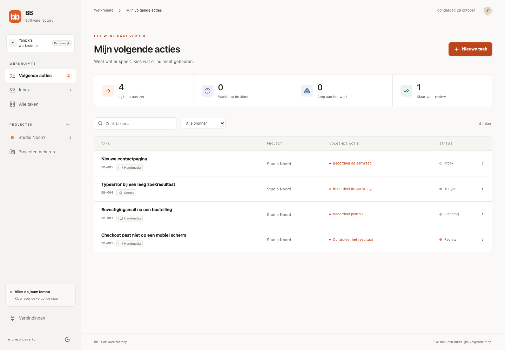

# BB

A software factory with a kanban board per project. Incoming work becomes a task with a clear next action, explicit client questions, a versioned plan, remote Amp execution, review evidence and a delivery record. The interface is in Dutch.



## Run it

Requires **Bun 1.4.4**. Remote execution also requires the [Amp CLI](https://ampcode.com/docs/cli).

```sh
bun install --frozen-lockfile
cp .env.example .env
bun dev
```

Open **http://localhost:5173**. The backend runs on port 4310. Start with **Voorbeeldproject laden** for synthetic examples, or create your own project. The app does not automatically import customer tickets.

For a built app:

```sh
bun run build
bun start
```

Open http://127.0.0.1:4310. Run one BB server per data directory.

## What works

- A project board with Inbox, Triage, Planning, In uitvoering, Review, Oplevering and Afgerond.
- A cross-project next-action queue showing whether you, the client or Amp is responsible.
- Explicit selection of Orbit projects across different clients. Sentry projects can join the same BB project.
- Manual tasks, source links, search, source filters and task conversations.
- Questions with a recipient, rationale, suggested answer and blocking phase. Client questions can become an editable, copyable message.
- Versioned plans. Approval is bound to the current version. Blocking answers invalidate approval so scope can be checked again.
- A durable Amp queue with bounded concurrency, streamed progress and continuation of the same remote thread.
- Review criteria, screenshots with positioned comments, previews, PR links, documents and actual check-status fields. Old evidence cannot authorize a new execution cycle.
- Explicit human review and delivery. A customer question can end in a reviewed answer without creating a PR.
- Read-only Orbit/Sentry intake, stable source-ID deduplication and a persistent Orbit webhook inbox.
- A project-scoped BB MCP endpoint for task context, questions, proposed plans and evidence.
- Responsive layout, light/dark themes, keyboard-accessible dialogs and live updates.

## Connect Amp

On the machine running BB:

```sh
amp login
```

Set `BB_AMP_ENABLED=true` in `.env`, restart BB, then set the project's **Amp-project** to `namespace/project`. Configure its repository, orb environment, secrets and MCP tools in Amp. `AMP_API_KEY` can replace interactive CLI login on an unattended host.

BB launches `amp -ox --stream-json --no-archive-after-execute` and stores the returned thread ID. Follow-up turns use `amp threads continue`. The CLI observes the execution; **the agent runs in an Amp Orb**. A disconnected observer does not stop the remote agent. BB marks that run interrupted and requires reconciliation instead of silently retrying it.

The project setting is optional for repo-less questions and investigations. Launches use an empty temporary directory so they cannot accidentally select BB's own repository.

Screenshots uploaded to BB accompany subsequent Amp turns as attachments. For screenshot URLs hosted by Amp, BB attempts authenticated download with `amp files get` and stores the image locally. Other screenshot URLs remain links. Private attachments can always be uploaded manually if download is unavailable.

**Optional live smoke test, consumes Amp usage:**

```sh
bun run test:amp
```

It starts one repo-less orb, receives a structured question, records an answer and continues the same thread to obtain an unapproved plan. Its database is separate from the app, at `data/amp-smoke.sqlite`.

### BB MCP

Set `BB_PUBLIC_URL` to an HTTPS origin reachable from the orb and set `BB_PASSWORD`. In **Verbindingen**, generate a key for the relevant BB project. Add the resulting endpoint and bearer token to that Amp project's remote MCP settings.

The endpoint exposes `get_task`, `ask_question`, `propose_plan` and `submit_evidence`. It cannot approve plans, accept reviews, mark delivery or read another project's tasks. Keys are stored as hashes; generating another key revokes the previous one.

The CLI's structured final report works without this callback connection. A Tailscale-only hostname is not automatically reachable from an Amp-hosted orb.

## Connect sources

### Teamleader Orbit

Set `ORBIT_MCP_URL` to your tenant's **Streamable HTTP MCP endpoint**. If required, set `ORBIT_MCP_TOKEN`. A coding assistant's MCP access does not automatically give the BB process credentials.

Open project settings, search Orbit and explicitly select the external projects. **Bronnen ophalen** imports active linked tickets, at most 100 per selected Orbit project. Repeating intake does not duplicate tasks. Unmapped webhook tickets land in the general inbox.

BB also supports a local project-catalog snapshot. It is clearly labelled as a snapshot and stores only IDs, names and client names. This supports project selection before a persistent Orbit connection is configured. Catalogs and customer data stay in SQLite, outside Git.

### Sentry

Set `SENTRY_AUTH_TOKEN`, `SENTRY_ORG` and, if needed, `SENTRY_BASE_URL` for your region. Use read-only access to projects and issues. Select the relevant Sentry projects in BB project settings, then fetch sources.

Intake currently imports a bounded window of unresolved issues, at most 100 per project, and reports when the result is limited. Scheduled reconciliation, full history and automatic CI polling are follow-up work.

### Orbit webhooks

BB accepts `POST /api/webhooks/orbit`, authenticated with `BB_ORBIT_WEBHOOK_SECRET`. See [the payload and forwarding guide](docs/webhooks.md).

An existing webhook receiver must forward to BB, or the sender must be pointed at BB's endpoint. Merely having the existing receiver's URL does not subscribe BB to its events. No existing receiver has been modified.

## Data and access

- SQLite, screenshots and local catalogs are in `data/`, ignored by Git.
- `.env` is ignored. `.env.example` contains configuration names, not credentials.
- Loopback access is the default. A non-loopback bind or configured public origin requires `BB_PASSWORD`.
- Public hosting needs HTTPS and a persistent disk. The current app is single-operator, not a multi-tenant SaaS.
- BB enforces its own workflow transitions, version checks and MCP scope. Amp's repository and external-tool permissions are configured in Amp. Phase instructions in prompts are not a security sandbox.
- No automatic merge, production deployment or client-message sending is implemented in BB.

Create a consistent database and screenshot backup:

```sh
bun run backup
```

Backups are written under `data/backups/`. Copy them to your own backup storage. To restore, stop BB, restore `bb.sqlite` and `uploads/` into a fresh data directory, and start with `BB_DATA_DIR` pointing there. Do not overlay an active database or its WAL files.

## Checks and current status

```sh
bun run check
```

This runs strict TypeScript, Biome, 30 tests and a production build. GitHub Actions runs the same checks. Tests cover routing, deduplication, exact-plan approvals, clarification, stale evidence, delivery, authenticated webhooks, MCP project boundaries, persistence and worker disconnection.

See [verification and remaining work](docs/status.md) and [architecture](docs/architecture.md).
