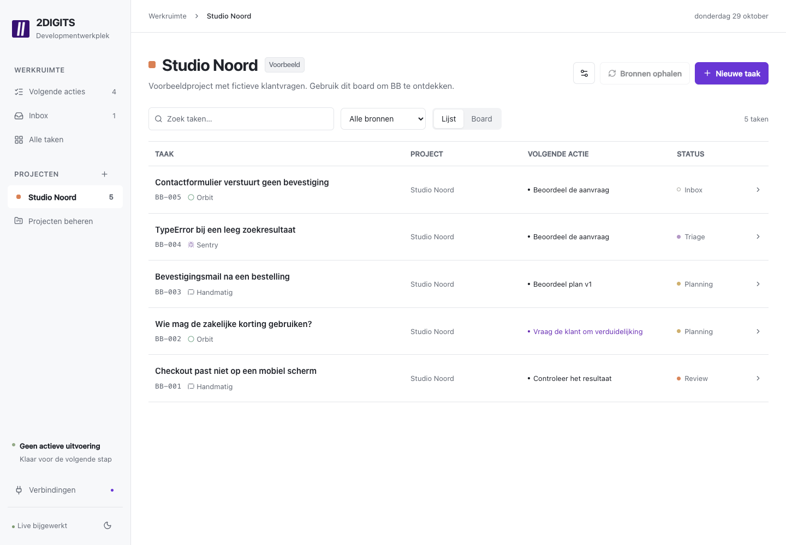

# 2DIGITS development workbench

A personal workbench for incoming tickets, Sentry issues and manual requests. Start with a task list, read the original request and conversation, then investigate, approve, implement and review. Project boards remain available. The interface is in Dutch; the repository and internal task IDs retain the BB name.



## Run it

Requires **Bun 1.4.4**. Remote execution also requires the [Amp CLI](https://ampcode.com/docs/cli).

```sh
bun install --frozen-lockfile
cp .env.example .env
bun dev
```

Open **http://localhost:5173**. The backend runs on port 4310. Start with **Voorbeeldproject laden** for synthetic examples, or create your own project. The app does not automatically import customer tickets.

For a built app:

```sh
bun run build
bun start
```

Open http://127.0.0.1:4310. Run one BB server per data directory.

## What works

- A project board with Inbox, Triage, Planning, In uitvoering, Review, Oplevering and Afgerond.
- A cross-project next-action queue showing whether you, the client or Amp is responsible.
- Explicit selection of Orbit clients. A BB project can combine several clients and Sentry projects. Existing Orbit project mappings remain supported.
- Manual tasks, source links, search, source filters and task conversations.
- Questions with a recipient, rationale, suggested answer and blocking phase. Client questions can become an editable, copyable message.
- Versioned plans. Approval is bound to the current version. Blocking answers invalidate approval so scope can be checked again.
- A durable Amp queue with bounded concurrency, streamed progress and continuation of the same remote thread.
- Automatic continuation after the final blocking answer, committed atomically with that answer. Changed scope returns to planning and requires fresh approval.
- Separate triage, planning, implementation, revision, technical review and delivery instructions, including reproduction, affected-flow verification, client language and billing rules.
- Review criteria, screenshots with positioned comments, previews, PR links, documents and actual check-status fields. Old evidence cannot authorize a new execution cycle.
- Explicit human review and delivery. A customer question can end in a reviewed answer without creating a PR.
- An editable delivery draft generated from actual results, with a reviewed-evidence fallback. Recording delivery does not send a client message or deploy code.
- Personal time records with internal/client classification and agreement notes. Existing time history remains readable.
- Read-only Orbit/Sentry intake, stable source-ID deduplication and a persistent Orbit webhook inbox.
- A project-scoped BB MCP endpoint for task context, questions, proposed plans and evidence.
- Responsive layout, light/dark themes, keyboard-accessible dialogs and live updates.
- A full-page ticket workspace, readable system typography, neutral surfaces and the official 2DIGITS favicon. Purple marks primary actions and active tabs. Ticket and project code loads on demand.
- Orbit conversation import, explicit internal-note labels, attachment metadata and original-source links. Refresh enriches existing signals without duplicating tasks or replacing operator-written descriptions.
- Sentry issue details and recent events fetched through MCP before requested triage/planning runs. Missing access stays visible alongside the last available snapshot.

## Connect Amp

On the machine running BB:

```sh
amp login
```

Set `BB_AMP_ENABLED=true` in `.env`, restart BB, then select an accessible **Amp-project** in project settings. The list comes from `amp projects list --json`; selecting an entry also fills its repository. BB validates access before accepting a requested run. Configure the orb environment, secrets and MCP tools in Amp. `AMP_API_KEY` can replace interactive CLI login on an unattended host.

BB launches `amp -ox --stream-json --no-archive-after-execute` and stores the returned thread ID. Follow-up turns use `amp threads continue`. The CLI observes the execution; **the agent runs in an Amp Orb**. A disconnected observer does not stop the remote agent. BB marks that run interrupted and requires reconciliation instead of silently retrying it.

A confirmed inaccessible-project launch failure without a thread is marked failed and points to project settings. Unknown exits and runs with a remote thread retain the interrupted status.

The project setting is optional for repo-less questions and investigations. Launches use an empty temporary directory so they cannot accidentally select BB's own repository.

Screenshots uploaded to BB accompany subsequent Amp turns as attachments. For screenshot URLs hosted by Amp, BB attempts authenticated download with `amp files get` and stores the image locally. Other screenshot URLs remain links. Private attachments can always be uploaded manually if download is unavailable.

**Optional live smoke test, consumes Amp usage:**

```sh
bun run test:amp
```

It starts one repo-less orb, receives a structured question, records an answer and automatically continues the same thread to obtain an unapproved plan. Its database is separate from the app, at `data/amp-smoke.sqlite`.

### BB MCP

Set `BB_PUBLIC_URL` to an HTTPS origin reachable from the orb and set `BB_PASSWORD`. In **Verbindingen**, generate a key for the relevant BB project. Add the resulting endpoint and bearer token to that Amp project's remote MCP settings.

The endpoint exposes `get_task`, `ask_question`, `propose_plan` and `submit_evidence`. It cannot approve plans, accept reviews, mark delivery or read another project's tasks. Keys are stored as hashes; generating another key revokes the previous one.

The CLI's structured final report works without this callback connection. A Tailscale-only hostname is not automatically reachable from an Amp-hosted orb.

## Connect sources

### Teamleader Orbit

Set `ORBIT_MCP_URL` to your **Streamable HTTP MCP endpoint** and `ORBIT_MCP_TOKEN` to a bearer credential accepted by that endpoint. The official endpoint is `https://api.orbit.teamleader.eu/mcp` and uses OAuth. BB's Orbit adapter currently accepts a bearer token only; it does not refresh Orbit OAuth tokens. A token from a gateway must use that gateway's matching URL. Use **Verbinding controleren** to verify access. A coding assistant's MCP access does not automatically give BB credentials.

Set `ORBIT_WEB_URL` to your tenant's web origin for ticket links. Open project settings, search Orbit and select clients. **Bronnen ophalen** imports active tickets, at most 100 per selected client. Each import reads ticket details and up to 100 conversation entries, including internal notes, and enriches previously imported tickets. Empty description fields fall back to the first customer-visible message. Markup is converted to plain text. Download URLs expire; refresh the ticket context to renew them.

Tickets do not need an Orbit project. Client routing takes precedence over legacy project mappings. Repeating intake does not duplicate tasks. Unmapped webhook tickets land in the general inbox. Source errors are reported separately so one unavailable connection does not block another source.

BB also supports a local client-catalog snapshot, labelled with its capture date. It retains only names and IDs and stays available if live access fails. Orbit company web links use CP identifiers; the MCP client API uses CL identifiers. Select verified catalog entries rather than deriving IDs from web links. Catalogs and customer data stay in SQLite, outside Git.

### Sentry

Set `SENTRY_MCP_URL=https://mcp.sentry.dev/mcp`, `SENTRY_ORG` and `SENTRY_BASE_URL` for your region. In **Verbindingen**, choose **Verbind Sentry via MCP** and finish the Sentry login. BB stores its own OAuth tokens in private SQLite settings. State expires after ten minutes, is consumed once, and the SDK uses PKCE and token refresh. Concurrent credential operations are rejected rather than racing. Select the relevant Sentry projects in project settings, then fetch sources.

The callback is `${BB_PUBLIC_URL}/api/sentry/oauth/callback`, or `http://localhost:4310/api/sentry/oauth/callback` locally. Changing the origin requires a fresh connection. Optional `SENTRY_AUTH_TOKEN` enables REST fallback. Both adapters use organization plus issue short ID for deduplication. MCP synchronization imports unresolved issues active in the past seven days, up to 100 per project.

Intake currently imports a bounded window of unresolved issues, at most 100 per project, and reports when the result is limited. Scheduled reconciliation, full history and automatic CI polling are follow-up work.

Requested triage and planning refresh `get_sentry_resource` and `search_issue_events` through MCP. The issue snapshot and ten recent events from the past seven days accompany the Amp prompt. Amp investigates relevant stack frames, releases, environments and linked events. Orbit research instead starts from the customer question and conversation; manual work first distinguishes a reported defect from a request or question.

### Orbit webhooks

BB accepts `POST /api/webhooks/orbit`, authenticated with `BB_ORBIT_WEBHOOK_SECRET`. See [the payload and forwarding guide](docs/webhooks.md).

An existing webhook receiver must forward to BB, or the sender must be pointed at BB's endpoint. Merely having the existing receiver's URL does not subscribe BB to its events. No existing receiver has been modified.

## Data and access

- SQLite, screenshots and local catalogs are in `data/`, ignored by Git.
- `.env` is ignored. `.env.example` contains configuration names, not credentials.
- Loopback access is the default. A non-loopback bind or configured public origin requires `BB_PASSWORD`.
- Public hosting needs HTTPS and a persistent disk. The current app is single-operator, not a multi-tenant SaaS.
- Keep one server per workspace database. The UI is intended for personal use.
- Time entries record actual developer minutes locally. They are not invoices or Orbit bookings. Agent runtime is not automatically billable time. Paid preparation requires an agreement note; uncertain classification can remain unclassified.
- BB enforces its own workflow transitions, version checks and MCP scope. Amp's repository and external-tool permissions are configured in Amp. Phase instructions in prompts are not a security sandbox.
- No automatic merge, production deployment or client-message sending is implemented in BB.

Create a consistent database and screenshot backup:

```sh
bun run backup
```

Backups are written under `data/backups/`. Copy them to your own backup storage. To restore, stop BB, restore `bb.sqlite` and `uploads/` into a fresh data directory, and start with `BB_DATA_DIR` pointing there. Do not overlay an active database or its WAL files.

## Checks and current status

```sh
bun run check
```

This runs strict TypeScript, Biome, the test suite and a production build. GitHub Actions runs the same checks. Tests cover source enrichment, Sentry context refresh, client routing, deduplication, exact-plan approvals, automatic continuation, stale evidence, generated delivery, time records, OAuth state/expiry/replay, authenticated webhooks, HTTPS reverse proxies, MCP project boundaries, persistence and worker failure classification.

See [verification and remaining work](docs/status.md) and [architecture](docs/architecture.md).
